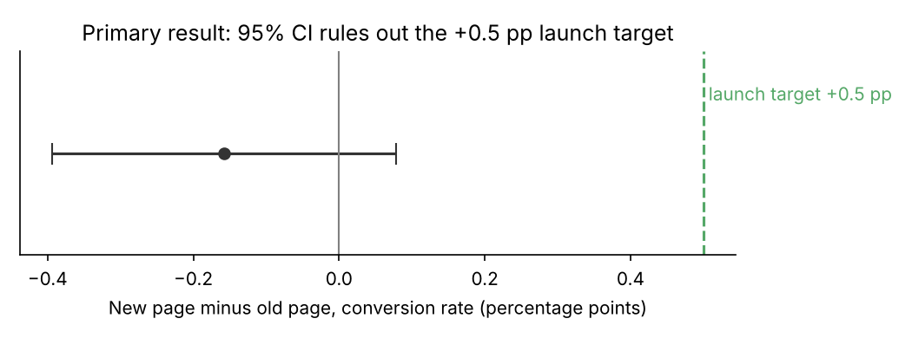
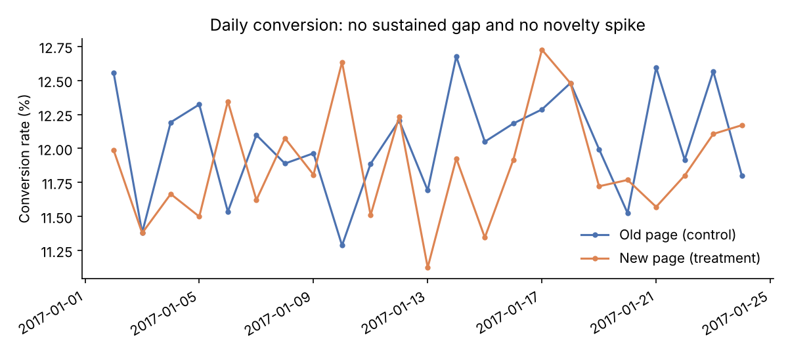
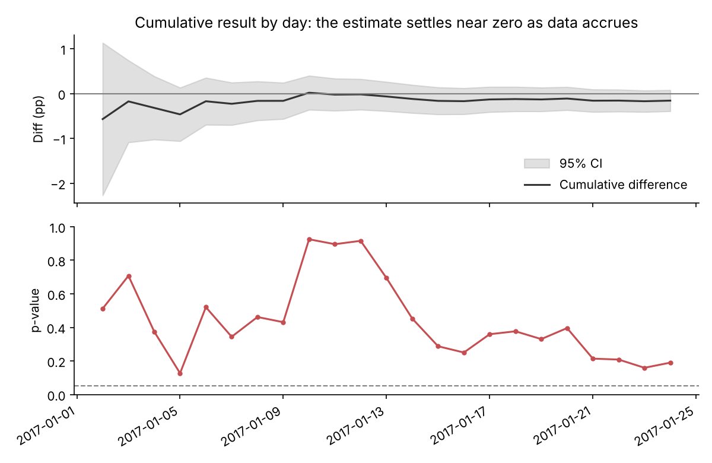
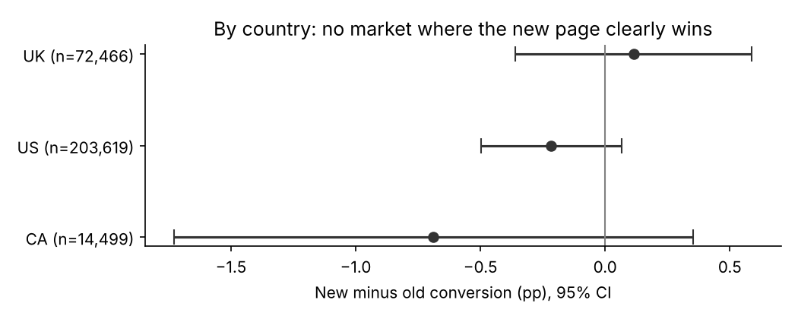

# Landing Page A/B Test: Launch Decision Analysis

**Question:** An e-commerce site tested a redesigned landing page against its current page. Should it launch the new page, keep the old one, or keep testing?

**Recommendation: keep the old page.** The new page did not improve conversion. The test was large enough to detect the lift the business needed (+0.5 pp), and the 95% confidence interval rules that lift out.

Built with **DuckDB SQL** (cleaning, metric tables) and **Python** (scipy, statsmodels, pandas, matplotlib), with automated tests for data quality and statistics.

---

## Key results

| | Old page (control) | New page (treatment) |
|---|---|---|
| Users | 145,274 | 145,310 |
| Conversion rate | 12.04% | 11.88% |

| Metric | Result |
|---|---|
| Difference (new − old) | **−0.16 pp** (−1.3% relative) |
| 95% confidence interval | −0.39 pp to +0.08 pp |
| Two-sided p-value | 0.19 |
| Sample-ratio-mismatch check | 49.99% / 50.01% split, p = 0.95 (healthy) |
| Users needed per arm to detect +0.5 pp (80% power) | 67,679, and the test had 145,274 |
| Smallest effect this test could detect | 0.34 pp |



## Approach

### 1. Decision rule, set before looking at results
- **Primary metric:** user-level conversion rate.
- **Test:** two-sided two-proportion z-test, α = 0.05.
- **Practical threshold:** the new page must lift conversion by at least **+0.5 pp** to justify build and maintenance cost. This threshold is an assumption made for this case study.
- **Rule:**
  - **Launch** if the lift is significant and positive.
  - **Keep the old page** if the test is adequately powered and the CI excludes the threshold.
  - **Otherwise, extend the test.**

### 2. Data quality and experiment health (SQL: [`sql/01_clean.sql`](sql/01_clean.sql))
- **Assignment errors:** 3,893 rows (1.32%) showed a page that didn't match the assigned group, e.g. a control user served the new page. It's impossible to know which experience these users actually got, so they were excluded. They were split evenly across arms (1,928 vs 1,965), so excluding them doesn't bias the comparison. In a real team I'd raise this with engineering as an assignment or logging bug.
- **Duplicate users:** kept each user's first exposure, giving 290,584 users with one row each.
- **Sample-ratio mismatch:** the split is 49.99/50.01 (χ² p = 0.95), so randomisation looks healthy.

### 3. Primary analysis
- **Result:** the new page converted 0.16 pp worse. The difference isn't statistically significant (p = 0.19).
- **Why that's still a clear answer:** the upper end of the 95% CI is +0.08 pp, well below the +0.5 pp target.
- **Power:** detecting +0.5 pp needed about 68k users per arm. With 145k per arm, the test could detect effects as small as 0.34 pp. So this is a well-powered null result, not an inconclusive one.

### 4. Robustness checks
- **Novelty effect:** compared the first and second halves of the test window. The first-half difference was −0.02 pp and the second-half −0.28 pp. Neither is significant, and the logistic-regression interaction p-value is 0.27. There's no early "new page excitement" that later faded, and no late improvement either.
  
- **Peeking:** recomputed the cumulative result on each of the 23 days. The p-value never dropped below 0.05 (minimum 0.13). Stopping early at any point would not have produced a false "win". Even so, the decision uses only the full planned sample.
  
- **Segments (exploratory):** no country shows a significant effect after Holm correction, and the treatment × country interactions aren't significant (p = 0.24 to 0.38). The UK point estimate is slightly positive (+0.12 pp, CI −0.36 to +0.59). That isn't evidence for a UK-only launch, because segment results like this are expected to vary by chance.
  

## Recommendation for product and engineering
1. **Don't launch** the new landing page. It's well powered, it shows no improvement, and the business target is ruled out.
2. **Fix the assignment and logging bug** behind the 1.3% of mismatched rows before the next experiment.
3. **For the next iteration:**
   - Pre-register the hypothesis, the primary metric and **guardrail metrics** such as bounce rate and revenue per visitor, which this dataset doesn't include.
   - Size the test with the power calculation in [`src/stats_utils.py`](src/stats_utils.py).
   - Test a bolder change if the team still wants a +0.5 pp lift. This redesign appears to be roughly neutral.

## Limitations
- The dataset has only one metric (conversion), so there are no guardrail, revenue or funnel-step metrics.
- The +0.5 pp practical threshold is an assumption made for this case study.
- The data is a simulated teaching dataset, so effects aren't from a live product.

## Project structure
```
sql/01_clean.sql        cleaning, assignment-issue audit, one row per user
sql/02_metrics.sql      arm, daily, cumulative and country metric tables
src/stats_utils.py      z-test, CI, SRM check, sample size and MDE
src/run_analysis.py     end-to-end pipeline: SQL → stats → decision → charts
tests/                  data-quality checks + statistics checked against statsmodels
reports/results.json    all numbers quoted above
reports/figures/        charts
data/raw/               ab_data.csv, countries.csv
```

## How to run
```bash
pip install -r requirements.txt
python src/run_analysis.py   # writes reports/results.json and reports/figures/
pytest -q                    # 13 tests
```

## BigQuery version

[`bigquery/`](bigquery/) reruns the same cleaning and metrics pipeline in Google BigQuery (GoogleSQL: `QUALIFY`, explicit schema load, the z-test computed in SQL). [`check_parity.py`](bigquery/check_parity.py) confirms that the BigQuery output matches the DuckDB results. To run it in the free BigQuery sandbox, follow [`bigquery/README.md`](bigquery/README.md).

## Data source
`ab_data.csv` and `countries.csv` are the simulated e-commerce A/B test data from Udacity's Data Analyst Nanodegree ("Analyze A/B Test Results"), as published in public GitHub repositories. They are used here for learning and portfolio purposes only.
